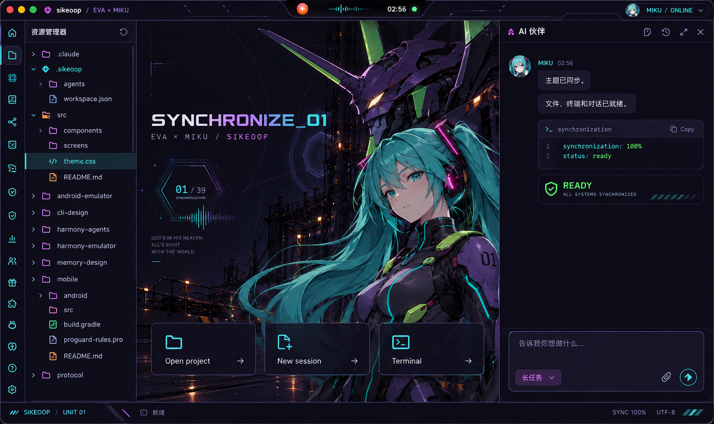

<div align="center">


# sikeoop

**给新手的 AI 代码编辑器**

有用的，没用的，迟早要用的，都在这儿了。

[官网与下载](https://sikeoop.modgert.online) · [更新公告](更新公告/) · [桌面版说明](sweet-code-desktop/README.md)

</div>

<br>

sikeoop 会读你的项目、改代码、跑命令。改什么先给你看，跑什么先说清楚，你点头它才动手。

它是一个本地运行的桌面应用（Electron + React + Monaco），底层是自己写的 Agent 循环，不绑定任何一家模型。对话、记忆和代码索引都留在你自己的电脑上。

<div align="center">

<br>
<sub>EVA × 初音未来 皮肤 · 设计效果图</sub>
</div>

## 有用的

今天打开就用得上。

| | |
|---|---|
| **改什么，先给你看** | 每处改动先变成一张卡片，红绿标出改了哪几行，再用一句大白话说为什么改。你点「同意」才写进文件。 |
| **跑什么，先说清楚** | 运行命令前先说明它是干嘛的。会删文件、会推到网上的命令额外标红。 |
| **改坏了，一键撤回** | 每一轮改了哪些文件都有快照，不满意就整轮撤回，不会 Git 也能回到刚才。 |
| **三种放手程度** | 每一步都问你；交给审批小助手替你把关；或者全程不问。危险的几类命令在任何模式下都会被拦下，推送和发布始终要你亲自点头。 |
| **模型掉链子，自己顶上** | 当前模型限流、欠费或断网时，备用模型自动接手同一步。 |
| **记得你，也记得上次做到哪** | 四层记忆，从当前对话到长期偏好。密钥和手机号在写入前抹掉，每一条都能在「上下文中心」里查看和删除。 |
| **先把门关好** | 读写文件只在你打开的项目里；装技能前先审核；网页和插件里叫 AI 干活的话，它只当资料，不照做。 |

## 没用的

对写代码毫无帮助，但做得很认真。

- **一条嘴毒的鲸鱼娘**：问简单问题会被笑两句，答案一个字不少。
- **EVA × 初音未来 皮肤**：整套重画的图标和壁纸，连更新提示都有专属卡片。
- **灵动岛**：屏幕顶上的一颗小胶囊，AI 在想、在改还是在等你，一眼就知道。
- **会叠起来的书签侧栏**、**提示音**，以及官网首页那片点一下会起涟漪的海。

## 迟早要用的

现在用不上没关系，写着写着会回来找它们。

- **一群 AI 一起干**：同时开 Claude Code、Codex 和已配置的模型，由「超级调度」拆任务、并行派活、汇总结果，全部任务在「调度台」里看得到、取消得了。
- **接入其他编程 CLI**：写一个 JSON，就能把 opencode 这类命令行 AI 接进终端一起排队。
- **定时自动化**：画一张小流程图，让它每天定点跑测试、出问题就修、修完再测。
- **群聊**：把几家模型拉进一个群讨论方案。
- **手机遥控**：用手机派活、看进度、点批准，全程端到端加密，中继只转发密文。安卓 App 内测中。

## 支持的模型

| 服务商 | 接入方式 |
|---|---|
| Claude | Anthropic 官方 SDK |
| OpenAI、Gemini、DeepSeek、通义千问、Kimi、智谱 GLM、豆包、MiniMax、OpenRouter、Ollama（本地） | OpenAI 兼容格式 |
| 其他 | 自己填接口地址 |

Key 用系统钥匙串加密保存在本机。用 Ollama 时，对话内容不离开你的电脑。

## 从源码运行

```bash
cd sweet-code-desktop
npm install
npm run dev          # 开发模式，带热更新
npm run dev:web      # 只在浏览器里跑界面，用假数据，不需要 Electron 和 Key
npm run typecheck
npm test
```

打包安装包：`npm run dist:mac` 或 `npm run dist:win`。更多说明见 [桌面版 README](sweet-code-desktop/README.md)。

只想用的话，直接到 [官网](https://sikeoop.modgert.online) 下载 Windows 或 macOS 安装包。

## 仓库结构

```
sweet-code-desktop/   桌面应用，项目主体：主进程、Agent 循环、渲染层
protocol/             手机与桌面之间的配对和加密协议
relay/                本地开发用的中继，只转发密文
hosting/              网页托管服务（Cloudflare Worker，目前仅本地运行）
sikeoop-android/      安卓 App
sikeoop-ios/          iOS App
sikeoop-site/         官网
harmony-agents/       鸿蒙开发用的子代理集群
harmony-emulator/     鸿蒙模拟器底座
android-emulator/     安卓模拟器底座
design/               皮肤、图标和视觉设计稿
pv/  sikeoop-PV/      宣传视频的素材和成片
docs/                 任务书和各阶段汇报
更新公告/              每个版本的更新说明
test/                 协议、中继和手机端的测试
```

## 技术栈

Electron 44 · React 19 · TypeScript 6 · Vite · Monaco · xterm + node-pty · Three.js · MCP SDK

<br>

<div align="center">
<sub>「看什么看，下载啊，杂鱼～」</sub>
</div>
