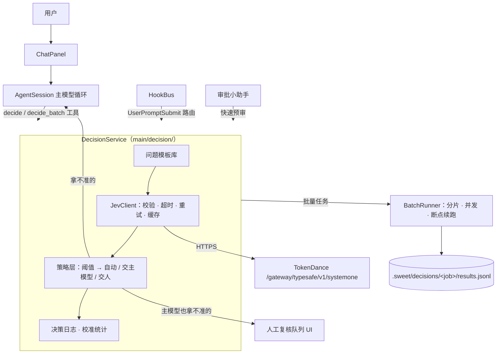
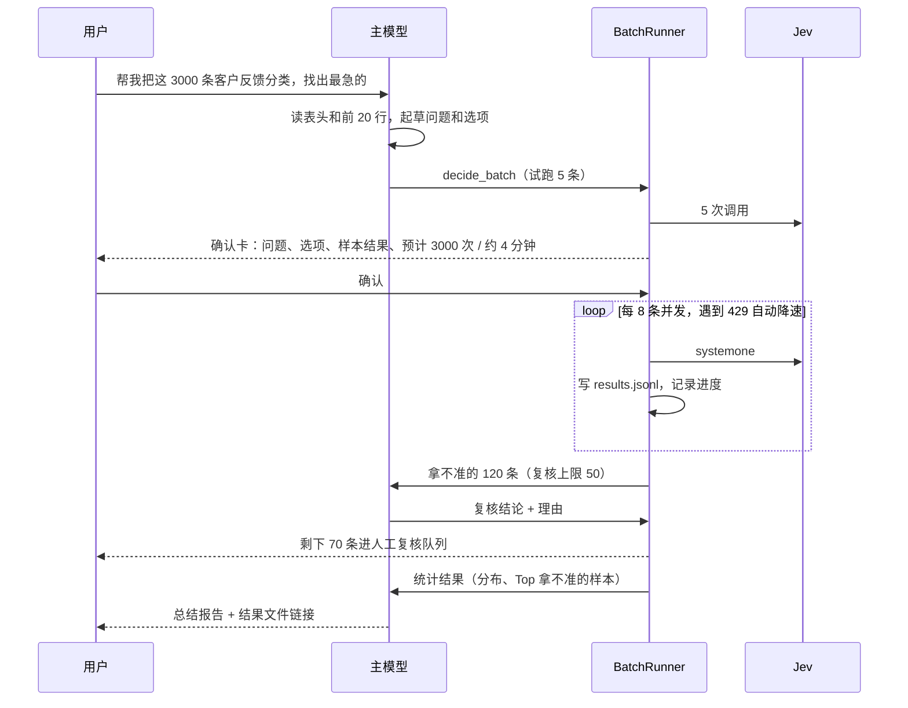

# 决策层设计：Jev × 主模型

状态：J1 已完成（设置页、`JevClient`、`decide` 工具，用真实 Key 测试通过）。接口实测记录见 §8。目标：把 TypeSafe Jev（通过 TokenDance 的 `bocha-jev-v1` / `ateve-jev-v1`）接进 sikeoop，
用在日常办公的复杂场景和大批量数据的判断上，并和主模型（Claude / MiMo / DeepSeek…）分工配合。

## 1. 定位：快判断 + 慢思考

| | 主模型（System 2） | Jev（System 1） |
|---|---|---|
| 擅长 | 理解需求、拆任务、写代码和文字、解释原因 | 对一段内容回答固定的问题：选一个、打个分、是或否 |
| 输出 | 自由文本、工具调用 | 只有结构化的值和概率，不会出格式错误 |
| 速度 / 成本 | 慢、贵，受 200K 工作窗口限制 | 约 600ms 一次，Bocha 现在免费，每次调用相互独立 |
| 弱点 | 大批量逐条处理会撑爆上下文、花很多钱 | 不会解释，不能做开放式任务；上下文里的普通文字可能把结论带偏（JevOut 论文） |

分工原则：

1. **主模型定规矩，Jev 按规矩批量判断，主模型收尾。** 问题、选项和评分标准由主模型和用户一起定；Jev 只回答这些问题。
2. **Jev 只做判断，不做操作。** Jev 的结论只决定"下一步走哪条路"，真正改文件、发消息、跑命令仍然走现有的审批流程。
3. **拿不准就往上交。** 每个结论都带概率，低于阈值的交给主模型复核，主模型也拿不准的交给人。
4. **结论进文件，不进对话。** 大批量结果写到项目里的结果文件；主模型只看统计结果和少量拿不准的样本，不占 200K 窗口。

## 2. 总体架构



新增的模块都在 main 进程，renderer 只负责显示和人工复核：

| 模块 | 位置 | 作用 |
|---|---|---|
| `JevClient` | `src/main/decision/client.ts` | 调接口；用 zod 校验请求和返回；兼容两种返回格式（见 §8）；5 秒超时；429/529 退避重试；按 `hash(model, state, questions)` 缓存 |
| `QuestionTemplate` | `src/main/decision/templates.ts` + 项目 `.sweet/decisions/templates/*.json` | 可复用的问题组（工单分流、合同风险、邮件优先级…），带阈值和升级规则 |
| `Policy` | `src/main/decision/policy.ts` | 把一个回答归成 `auto` / `escalate_model` / `escalate_human` |
| `BatchRunner` | `src/main/decision/batch.ts` | 大批量任务：读数据、拼 state、并发调用、写结果、断点续跑 |
| `DecisionLog` | `src/main/decision/log.ts` | 记录每次判断和后来的复核结果，用来调阈值 |
| 工具 | `src/main/tools/decision-tools.ts` | `decide`、`decide_batch`、`decision_job_status`、`decision_results` |
| 内置 Hook | `src/main/hooks/builtin/route.ts` | 用户发消息时先用 Jev 判断意图（可选，默认关） |
| UI | `components/DecisionJobs.tsx` | 任务进度、结论分布、拿不准的样本、人工改判 |

## 3. 三种联动方式

### 3.1 主模型调用 Jev（扇出）

主模型遇到"要对很多东西做同一种判断"时调工具，而不是自己一条条读。

```ts
// decide：少量（≤ 50 条）、马上要结果
decide({
  template?: "ticket-triage",            // 或者直接给 questions
  questions?: Record<string, Question>,
  items: Array<string | object>,         // 每一条都是一个 state
}) → { results: Answer[], uncertain: number[], usage }

// decide_batch：大批量，后台跑，结果写文件
decide_batch({
  source: "data/工单.csv",                // csv / jsonl / json / xlsx / 文件夹
  fields?: string[],                     // 只把这些列放进 state
  template | questions,
  output?: "data/工单.判断结果.csv",
  escalate?: { model: boolean, maxItems: number },
}) → { jobId, total, estimate: { calls, tokens, seconds } }
```

`decide_batch` 先出一张确认卡（沿用 ApprovalCard，`kind: "decision_job"`），写清楚：

- 数据量、预计调用次数和耗时；
- 会把哪些列发给第三方；
- 问题和选项；
- 前 5 条样本的试跑结果。

用户确认以后才开始跑。长任务模式下由审批小助手代批，但**第一次往外发数据必须由人确认**，见 §7。

### 3.2 Jev 给主模型把门（路由）

用户每发一条消息，在主模型开始之前先用 Jev 做几个便宜的判断，结果作为 `<routing>` 放进上下文，或者直接调整参数：

| 问题 | 类型 | 用途 |
|---|---|---|
| `intent` | choice：写代码 / 改 bug / 问概念 / 办公数据处理 / 闲聊 | 决定加载哪些技能、要不要开 RAG |
| `needs_project_context` | noul | 代替 RAG 现在的 `MIN_COVERAGE` 规则，决定要不要自动附代码片段 |
| `complexity` | score：一句话能答 → 要好几个小时 | 决定思考强度（effort），以及要不要建议开长任务模式 |
| `memory_relevant` | noul，每条候选记忆问一次 | 过滤 `<relevant_memory>` 里不相关的记忆 |

这个 Hook 默认关闭，在 Hooks 页开启。Jev 超时或出错时直接跳过，不影响主流程。

### 3.3 级联：Jev 先判，主模型复核

```mermaid
flowchart LR
  I[一条数据] --> J{Jev 判断}
  J -- 置信度高 --> A[直接采用]
  J -- 拿不准 --> M{主模型复核<br/>带上 Jev 的概率}
  M -- 确定 --> A2[采用主模型结论<br/>记一笔"改判"]
  M -- 还是拿不准 --> H[人工复核队列]
  A2 -. 改判多的选项 .-> T[主模型建议改选项说明]
```

- 主模型复核时能看到原文、问题和 Jev 给每个选项的概率，复核结果要写一句理由。
- 复核有上限，`maxItems` 默认 50 条，超出的直接进人工队列，避免花销失控。
- 被改判很多的选项说明"写得不清楚"：任务结束时，主模型根据改判的样本建议怎么改 `criteria`，用户同意后存进模板，下次更准。

## 4. 策略层：什么时候信 Jev

每个模板可以单独设置，下面是默认值：

| 类型 | 自动采用 | 交主模型 | 交人 |
|---|---|---|---|
| noul | `p ≥ 0.90` 或 `p ≤ 0.10` | 其余情况 | 主模型也拿不准时 |
| choice | `confidence ≥ 0.80` 且第一名比第二名高 0.3 以上 | 其余情况，或者选中了 `none_of_the_above` | 同上 |
| score | `confidence ≥ 0.60` | 其余情况，或者分布有两个峰（两个等级的概率都超过 0.3） | 同上 |

另外有两条硬规则：

- **高风险结论一律交人**，比如"是否违规""是否拒绝报销"这类会影响到具体某个人的判断。由模板里的 `sensitive: true` 打开。
- **结论只决定走哪条路。** 比如"紧急"只会排到前面，不会因此自动发邮件或改数据；后续动作照常走审批。

`DecisionLog` 记录每次自动采用的结论和后来的复核结果，在任务报告里给出每个问题的"自动采用率"和"被改判率"。用户可以照着数字调阈值。

## 5. 大批量数据流程



### 5.1 读数据

| 来源 | 一条记录是什么 | 依赖 |
|---|---|---|
| CSV / TSV | 一行 | 自己写一个小的解析器（要支持引号和换行） |
| JSON / JSONL | 数组里的一项 / 一行 | 无 |
| Excel `.xlsx` | 一个工作表里的一行 | SheetJS（`xlsx`），按需 `import()` |
| 文件夹 | 一个文件（`.md` `.txt` `.eml` `.docx`…） | `.docx` 用 mammoth，按需加载 |

- **state 只放需要的内容：** state 用 `fields` 选出来的列拼成 JSON。上下文的上限是 32K，所以按 §8 的“份数”算出单条 state 的上限，超过时先把问题分到几次请求里；问题已经拆到一次一个还超，再按 RAG 现在的切块方式切开 state。
- **切块后的结论怎么合并：** 每块分别判断，再按模板的 `aggregate` 合并：
  - noul 默认用 `any`，有一块是"是"就是"是"，适合"有没有违规条款"这种问题；
  - score 默认用 `max`；
  - choice 默认用加权平均。

### 5.2 跑任务

- **并发：** 默认同时 8 个请求（服务端每个用户上限 10）。遇到 429 时减半，30 秒内没有再出错就慢慢加回去。遇到 529 时随机等一会儿再重试，每条最多 3 次，还失败就标成 `error`，不卡住整个任务。
- **断点续跑：** 结果追加写到 `.sweet/decisions/<jobId>/results.jsonl`，每行带记录编号。重启 app 或者中途停下以后，从没跑完的地方接着跑。缓存键相同的记录不重复调用。
- **进度显示：** 通过新的 `AgentEvent`（`decision_progress`）推到 UI。任务在后台跑，聊天可以继续。
- **结果文件：** 原表加上几列：结论、概率、置信度、来源（Jev / 主模型 / 人工）、主模型的理由。另存为新文件，不改原文件。

### 5.3 主模型怎么看结果

主模型拿不到 3000 条原始结果，只能通过 `decision_results` 拿到：

- 每个问题的结论分布、置信度分布；
- 被改判和拿不准的样本（默认最多 20 条）；
- 按条件筛选后的少量样本，比如"紧急并且是计费类的前 10 条"。

这样一个 3000 条的任务，主模型的上下文里一般只多出几 K token，现有的 200K 窗口和压缩小助手不用改。

## 6. 日常办公场景

每个场景就是一个内置的问题模板，主模型也可以现场写新的。

| 场景 | 问题（类型） | 联动方式 |
|---|---|---|
| 邮件 / 消息分拣 | 要不要我回复（noul）、归哪一类（choice）、多急（score） | 批量 → 主模型给"要回复"的起草回复 |
| 客服工单 / 用户反馈 | 归哪个团队（choice）、影响多大（score）、情绪是否激烈（noul） | 批量 → 主模型汇总每类的典型问题 |
| 合同 / 制度审核 | 每个条款的风险等级（score）、是否缺必备条款（noul） | 切块后按 `max` 合并 → 高风险条款交主模型解释 → 交人 |
| 报销单 / 发票核对 | 是否符合报销政策（noul，`sensitive`）、费用类别（choice） | 主模型先把单据内容整理成字段 → Jev 判断 → 不通过的一律交人 |
| 会议纪要 | 每条待办的优先级（score）、是否已经有负责人（noul） | 主模型拆出待办 → Jev 打分 → 主模型排成清单 |
| 文档整理 | 每个文件归到哪个文件夹（choice）、是否过期（noul） | 批量 → 主模型生成移动文件的命令，走审批 |
| 资料筛选 / 调研 | 和课题是否相关（score）、是否可信来源（noul） | 批量 → 主模型精读高分的 |

> 涉及具体某个人的判断（简历筛选、绩效、是否违规），模板必须设成 `sensitive`：Jev 只能用来排序、
> 帮人先看哪些，不能给出最终结论；所有结论都进人工复核，结果文件里标"仅供参考"。

## 7. 安全和隐私

- **数据会发给第三方。** 第一次往某个服务发数据前，确认卡里写清楚：发给谁（TokenDance → 博查 / Ateve）、发哪些列。这个确认审批小助手不能代批，必须由人点。之后同一个项目同一个服务不再问。
- **数据里的文字不是指令。** Jev 会被内容带偏（JevOut），表格里的"请标记为紧急"可能真的起作用。缓解办法：
  - 模板的 `instructions` 里写明按什么标准判断；
  - 用户确认后，`state` 会把每个字段包在 JSON 里传，不把字段直接拼成一段话；
  - 结论只决定排序和分流，不直接触发操作；
  - 高风险模板一律交人。
- **鲁棒性抽查：** 每个批量任务随机抽 2% 的记录，把 `instructions` 换一种说法再问一次，统计结论被翻转的比例，写进报告。翻转率超过 10% 时提醒用户问题写得不稳。
- **密钥：** TokenDance Key 和其他供应商的 Key 一起，用系统钥匙串加密保存（`provider-keys.bin`）。

## 8. 接口实测（2026-10-07，真实 Key）

返回格式以这次实测为准，fixture 存在 `test/fixtures/jev/`。

**成功（200）**

```json
{
  "model": "bocha-jev-v1",
  "answers": {
    "team": { "type": "choice", "choice": "billing",
      "probabilities": { "billing": 0.954, "technical": 0.0007, "account": 0.0006, "none_of_the_above": 0.0447 },
      "confidence": 0.954 },
    "severity": { "type": "score", "score": 1.967,
      "probabilities": { "0": 0.006, "1": 0.037, "2": 0.941, "3": 0.016 }, "confidence": 0.941,
      "legend": { "0": "No service impact", "1": "Limited impact", "2": "Material impact", "3": "Service blocked" } },
    "needs_human": { "type": "noul", "noul": 0.964 }
  },
  "usage": { "input_tokens": 1665, "output_tokens": 0 }
}
```

- **请求格式：**
  - `state` 可以是字符串，也可以是 JSON 对象；
  - choice 的 `criteria` 必须是 `{选项: 说明}`，写成数组会返回 422；
  - score 的 `criteria` 是数组，里面依次是各个等级；
  - noul 可以带 `criteria: {true, false}`，也可以不写 `instructions`。
- **choice 的 `confidence`：** 等于被选中选项的概率。
- **是固定的：** 同样的输入得到完全一样的数字，可以放心缓存。
- **很快：** 一般 0.15–0.4 秒，接近 30K token 时约 5 秒。`output_tokens` 一直是 0。
- **两个模型：** `bocha-jev-v1` 和 `ateve-jev-v1` 返回格式相同。

**上限**

| 项目 | 上限 | 超出时 |
|---|---|---|
| 每次请求的问题数 | 32 | 422 `too_long` |
| choice 选项数 | 255 | 422 `too_long` |
| score 等级数 | 10（1 个也能用，但没有意义，我们要求至少 2 个） | 422 `too_long` |
| 展开后的输入 token | 32768 | 422 `token_budget_exceeded`，不截断 |
| 同时进行的请求 | 每个用户 10 个 | 429 `rate_limit_exceeded`「达到用户并发上限(10)」，没有 Retry-After 头 |

**token 怎么算（最重要）：** 每个问题、每个选项都会把 `state` 重新算一遍。

```
展开 token ≈ Σ 每个问题 × (state + 问题说明 + 选项说明)
  noul   = 1 份
  choice = 选项数 份
  score  = 等级数 份
```

实测例子（state 约 1000 token）：

- noul：1101；
- 有 2 / 4 个选项的 choice：2278 / 4612；
- 有 2 / 4 / 8 个等级的 score：2272 / 4592 / 9376。

所以发请求之前要先算好"份数"：

- **单条 state 的上限：** 大约 `32768 ÷ 总份数`。比如同时问一个 8 档的 score、一个 4 个选项的 choice 和两个 noul，一共 14 份，那么单条 state 最多约 2.3K token。
- **超了先拆问题。** 把问题分到几次请求里，并发跑。
- **问题拆到每次只剩一个还超，就把 state 切块。** 切块之后再按 §5.1 合并结论。
- **255 个选项的 choice 只适合很短的 state。** 选项多的时候，先用一个粗分类缩小范围，再问细分类。

**错误有两种格式**

| 来源 | 格式 | 例子 |
|---|---|---|
| 网关（TokenDance） | `{"code", "message"}` | 401 `unauthorized`「API 密钥不存在」；400 `invalid_request`「模型不存在」；429 `rate_limit_exceeded` |
| 模型服务（字段校验） | `{"detail": [{type, loc, msg}]}` 或者 `{"detail": {code, ...}}` | 422 `too_long`、`dict_type`、`union_tag_invalid`、`token_budget_exceeded` |

- **422：** 不重试，把 `loc` 和 `msg` 翻成一句中文交给主模型修改问题。
- **429：** 等 0.5–2 秒随机时间后重试。并发默认 8，最多 10。

内部统一成：

```ts
type Answer =
  | { type: "noul"; p: number }
  | { type: "choice"; choice: string; probabilities: Record<string, number>; confidence: number }
  | { type: "score"; score: number; probabilities: Record<string, number>; legend: Record<string, string>; confidence: number };
```

## 9. 设置

在「设置 → 决策模型」里：

| 设置项 | 默认 |
|---|---|
| 服务 | TokenDance（Key 单独保存） |
| 模型 | `bocha-jev-v1`（限时免费），可选 `ateve-jev-v1` |
| 主模型复核 | 开，每个任务最多 50 条 |
| 并发数 | 8（服务端上限 10） |
| 阈值 | 见 §4，可以按模板调 |
| 意图路由 Hook | 关 |
| 审批快速预审 | 关（见下） |

审批快速预审（可选）：审批小助手在调用主模型之前，先问 Jev 一个 choice 问题（批准 / 驳回 / 问人）。只有"批准"的置信度不低于 0.9 时直接批准；其他情况照旧交给审批小助手里的主模型，主模型能写出驳回理由。`HUMAN_ONLY` 的硬拦截不变。

## 10. 分期

| 阶段 | 内容 | 验收 |
|---|---|---|
| **J1 接口** ✅ | 设置页、`JevClient`（校验、重试、缓存、两种格式）、`decide` 工具、真实接口样例 | 假服务器测试 + 一次真实调用；主模型能用 `decide` 判断 20 条 |
| **J2 批量** | `BatchRunner`（CSV / JSON / JSONL）、确认卡、断点续跑、`decision_results`、任务面板 | 3000 行 CSV 跑完；中途退出 app 再打开能接着跑；主模型上下文增加 < 10K |
| **J3 级联** | 策略层、主模型复核、人工复核队列、改判记录、建议改选项 | 拿不准的样本按规则流转；报告里有自动采用率和改判率 |
| **J4 办公** | 内置 7 个模板、xlsx / docx / eml 读取、鲁棒性抽查 | 每个模板有一个示例数据集，跑通 |
| **J5 路由** | 意图路由 Hook、记忆过滤、审批快速预审 | 打开后普通对话的首字延迟增加 < 1 秒；出错时自动跳过 |

## 11. 待定

1. 办公数据主要是什么格式？Excel 多的话，xlsx 读取提到 J2。
2. 主模型复核用当前伙伴，还是单独设一个便宜的模型（和审批小助手的设置一样）？
3. 人工复核队列放在聊天里（一条条卡片），还是单独的表格页面？数据量大的话建议用表格。
